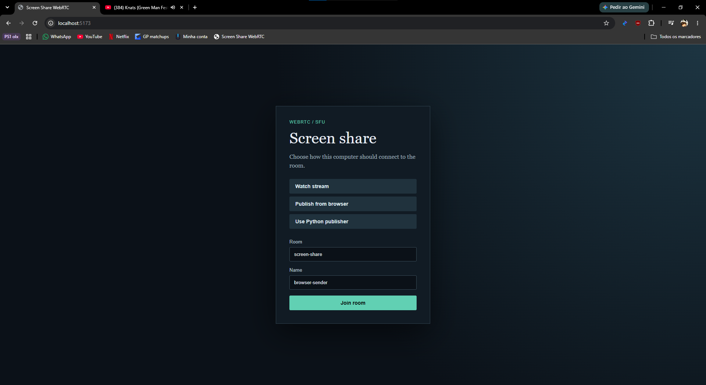
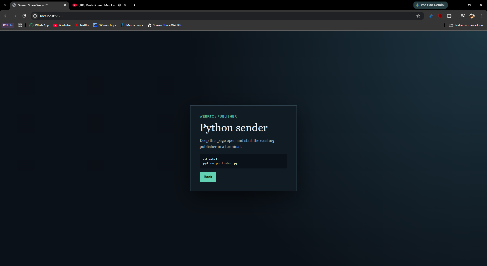
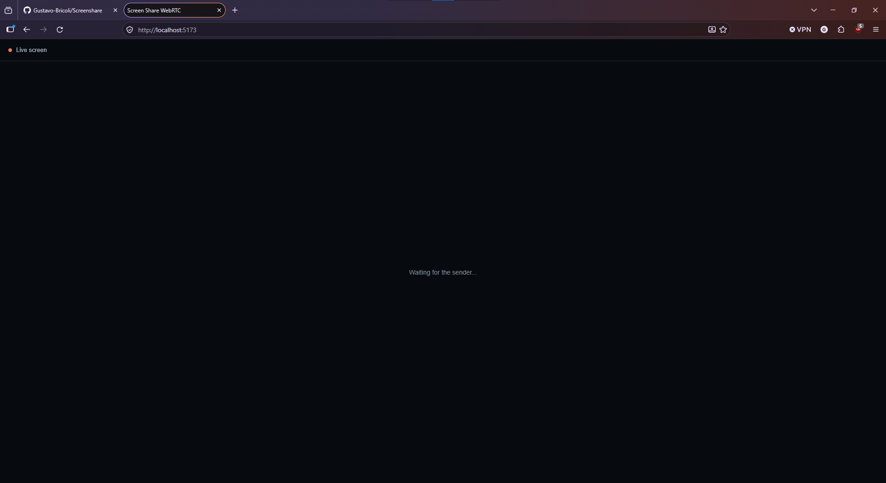
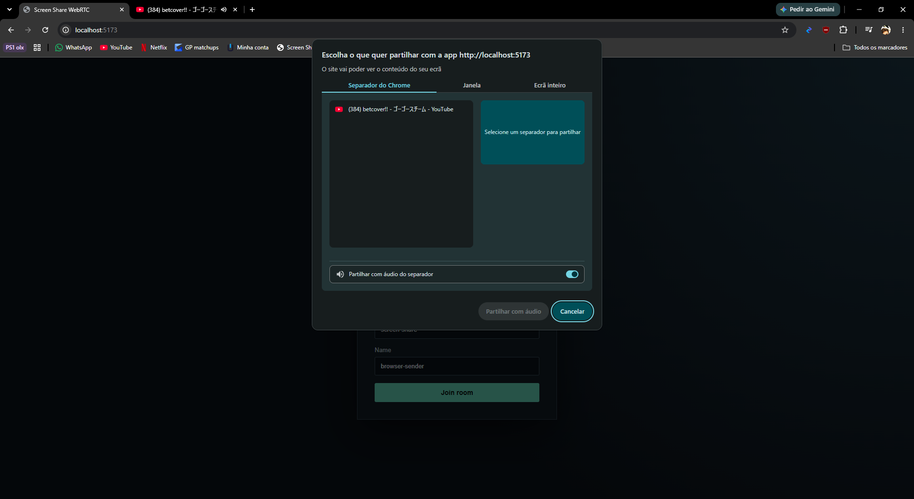
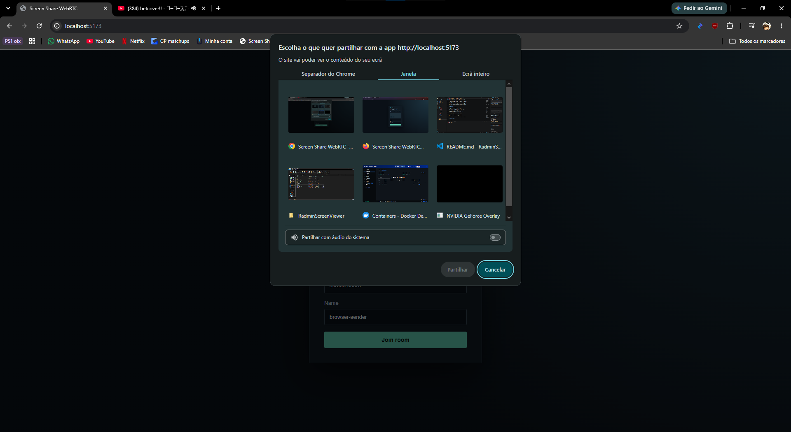
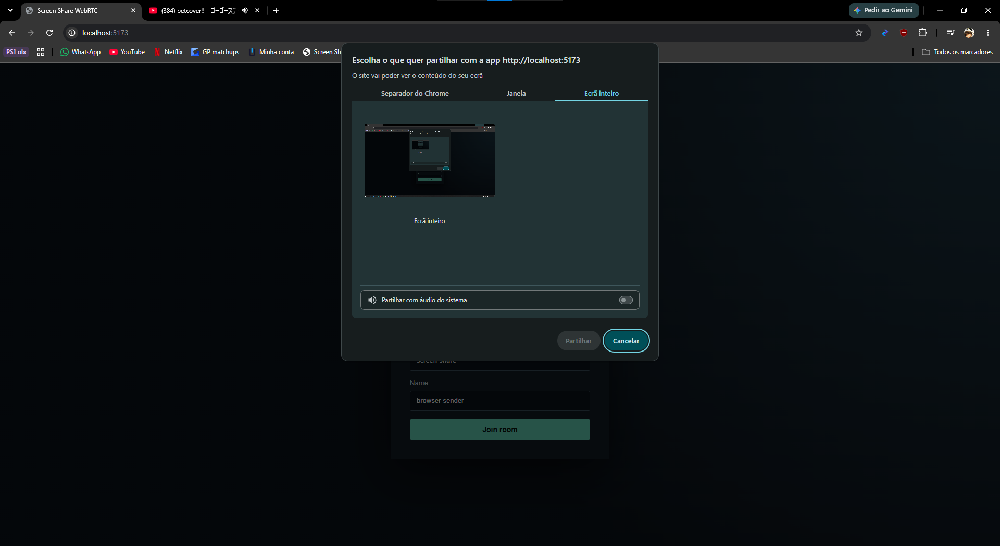
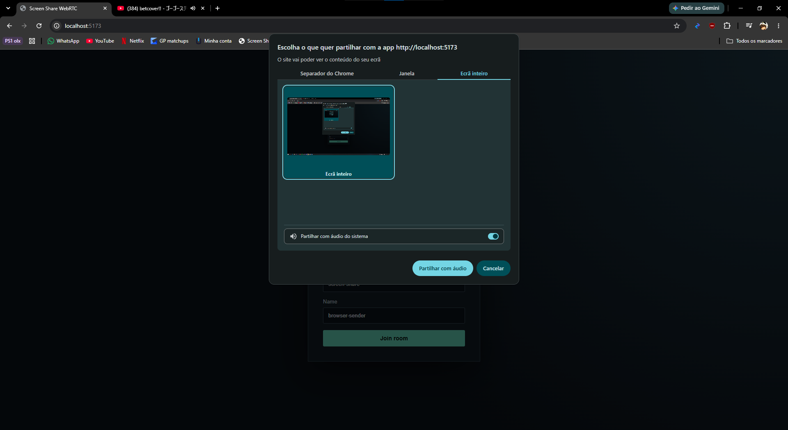
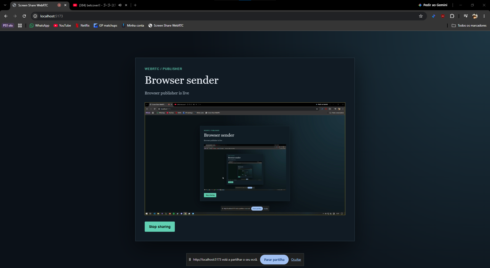
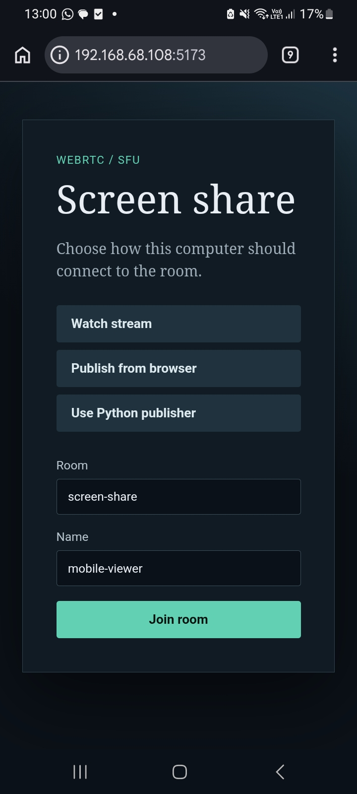
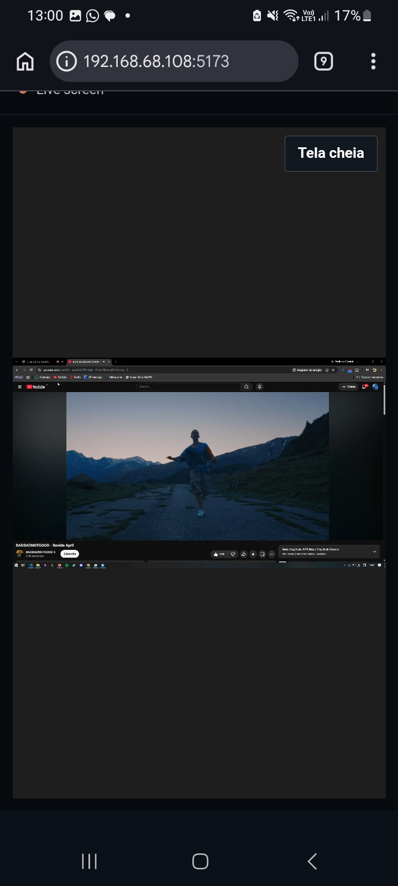

# Radmin Screen Viewer

Aplicação experimental de transmissão de tela e áudio em tempo real, desenvolvida
para estudar comunicação multimídia, WebRTC, captura de dispositivos e arquitetura
cliente-servidor.

O projeto permite que um computador publique sua tela em uma sala LiveKit e que
outros dispositivos acompanhem a transmissão pelo navegador. O foco atual é uma
solução local, simples de executar e adequada para demonstração de conceitos de
redes, frontend e backend.

## Funcionalidades

- Transmissão de tela em tempo real via LiveKit/WebRTC.
- Transmissão opcional do áudio do sistema.
- Visualização pelo navegador em computadores e celulares.
- Modo de publicação pelo navegador, usando a API `getDisplayMedia`.
- Modo de publicação por um processo Python, com captura de tela e áudio do
  sistema.
- Salas e identidades configuráveis na interface.
- Visualização em tela cheia.
- Servidor HTTP para emitir tokens temporários de acesso à sala.

## Demonstração

A página inicial dá três opcões ao usuário. Assistir alguma transmissão já existente, transmitir sua tela pelo navegador ou transmitir sua tela usando script de python.




Quando se quer transmitir sua tela, é só mudar o nome e apertar no botão.


Alguma opções do que transmitir irão aparecer. Uma guia específica do navegador,  

uma janela ativa do computador

ou uma tela inteira.

Você também tem a opcão de escolher se quer transmitir com ou sem áudio.


Depois de escolhido, você estará transmitindo sua tela em uma sala.


É possível assistir a transmissão pelo celular também.



## Tecnologias utilizadas

### Frontend

- React 19
- Vite
- JavaScript (ES Modules)
- `livekit-client`
- `@livekit/components-react`
- HTML5 Fullscreen API

### Backend e infraestrutura

- Node.js
- Express
- `livekit-server-sdk`
- LiveKit Server como SFU (Selective Forwarding Unit)
- Docker Compose
- WebRTC para transporte de áudio e vídeo em tempo real

### Publicador Python

- Python 3
- LiveKit RTC SDK
- `mss` para captura da tela
- `soundcard` para captura do áudio do sistema
- NumPy e Pillow para processamento dos frames

## Arquitetura

O projeto é dividido em três componentes principais:

```text
┌──────────────────────┐       HTTP /api/token       ┌──────────────────────┐
│ React + Vite         │ ──────────────────────────> │ Node.js + Express    │
│ Viewer ou Publisher  │ <──── token + URL LiveKit ─ │ Emissor de tokens    │
└──────────┬───────────┘                             └──────────────────────┘
           │ WebSocket/WebRTC
           │
           ▼
┌──────────────────────┐
│ LiveKit Server       │
│ SFU                  │
│ Sala "screen-share"  │
└───────┬──────────────┘
        │
        ├── Publicador pelo navegador
        │   (getDisplayMedia)
        │
        ├── Publicador Python
        │   (mss + soundcard)
        │
        └── Viewers
            (PC, Chrome/Edge ou celular)
```

### Fluxo de conexão

1. O frontend solicita ao servidor Node um token para uma sala e uma identidade.
2. O servidor cria um JWT com permissões de `viewer` ou `publisher`.
3. O cliente conecta-se ao LiveKit usando o token recebido.
4. Um publicador envia as faixas de tela e áudio para o LiveKit.
5. Os viewers assinam as faixas publicadas e exibem a tela recebida.

O servidor Node não transporta os frames. Ele apenas emite tokens e expõe um
endpoint de health check; o tráfego multimídia passa pelo LiveKit.

## Estrutura do projeto

```text
.
├── webrtc/
│   ├── src/main.jsx       # Interface React, viewer e publisher do navegador
│   ├── src/styles.css     # Estilos da aplicação
│   ├── server.mjs         # API Express para tokens e health check
│   ├── publisher.py       # Publicador Python de tela e áudio
│   ├── docker-compose.yml # Frontend, API, LiveKit e publisher
│   ├── Dockerfile         # Imagem Node para frontend e API
│   ├── Dockerfile.publisher # Imagem do publicador Python
│   ├── livekit.yaml       # Configuração do servidor LiveKit
│   ├── vite.config.js     # Dev server e proxy da API
│   ├── package.json       # Dependências e scripts JavaScript
│   └── requirements.txt   # Dependências Python
├── UDFBruto/              # Implementação/protótipo Python legado
├── screenshare0.1/        # Protótipo inicial de captura
├── screenshare_TCP/       # Protótipo baseado em TCP
└── screenshareaudio0.1/   # Protótipo inicial com áudio
```

A pasta `webrtc` contém a implementação recomendada atualmente. As demais pastas
registram versões anteriores e experimentos do projeto.

## Requisitos

- Windows, Linux ou macOS para o desenvolvimento local.
- Docker Desktop com Docker Compose.
- Uma rede local acessível pelos dispositivos que atuarão como viewers.

Node.js/npm só são necessários para executar a aplicação fora do Docker. Python
3.10 ou superior só é necessário para executar o publicador Python diretamente no
Windows.

## Como executar

### 1. Configurar variáveis de ambiente

Crie o arquivo local a partir do exemplo:

```powershell
Copy-Item .env.example .env
```

Exemplo de configuração:

```env
LIVEKIT_URL=ws://YOUR_PC_LAN_IP:17880
LIVEKIT_API_KEY=devkey
LIVEKIT_API_SECRET=secret
PORT=8787
```

Substitua `YOUR_PC_LAN_IP` pelo endereço IP do computador que está executando o
LiveKit. O arquivo `.env` é local e não deve ser versionado.

### 2. Iniciar todos os serviços

No diretório `webrtc`, o Compose inicia o frontend, a API de tokens e o LiveKit:

```powershell
docker compose up --build -d
```

Para acompanhar os logs:

```powershell
docker compose logs -f frontend api livekit
```

O Compose publica as seguintes portas:

| Porta | Protocolo | Uso |
|---|---|---|
| `5173` | TCP | Interface web do Vite (container `frontend`) |
| `8787` | TCP | API Node de tokens |
| `17880` | TCP | LiveKit/WebSocket |
| `17881` | TCP | LiveKit RTC |
| `17882` | UDP | LiveKit RTC |

Se o endereço IP da máquina mudar, atualize o `node_ip` em `livekit.yaml` e o
`LIVEKIT_URL` em `.env`.

O endpoint de verificação fica disponível em:

```text
http://localhost:8787/api/health
```

### 3. Escolher o modo de uso

Na interface, escolha uma das opções:

- **Watch stream**: entra como viewer e assiste à transmissão.
- **Publish from browser**: publica a tela pelo navegador; o navegador solicitará
  permissão para escolher uma tela, janela ou aba.
- **Use Python publisher**: mantém a página aberta e usa o processo Python para
  publicar a tela e o áudio do sistema.

O publicador Python pode ser iniciado pelo Compose:

```powershell
docker compose --profile python-publisher up --build -d
```

O publicador Python usa por padrão a sala `screen-share`, a identidade
`python-sender`, até 30 FPS e resolução máxima de 1920x1080. Esses valores podem
ser ajustados por variáveis como `LIVEKIT_ROOM`, `LIVEKIT_IDENTITY`,
`LIVEKIT_VIDEO_FPS`, `LIVEKIT_MONITOR`, `LIVEKIT_VIDEO_MAX_WIDTH` e
`LIVEKIT_VIDEO_MAX_HEIGHT`.

O profile Python é opcional. O `mss` e o `soundcard` precisam acessar a tela e o
áudio do sistema; no Docker Desktop para Windows esses dispositivos não são
compartilhados automaticamente com containers Linux. Se a captura não estiver
disponível, use **Publish from browser** ou execute o publicador diretamente no
Windows. Para parar todos os serviços:

```powershell
docker compose down
```

## Segurança e escopo atual

Esta configuração foi criada para desenvolvimento local:

- As credenciais do LiveKit são de desenvolvimento.
- O endpoint de token não possui autenticação de usuário.
- CORS está aberto para facilitar os testes.
- Não há gerenciamento de contas, autorização persistente ou auditoria.
- Não é recomendado expor o servidor diretamente à internet sem implementar
  autenticação, HTTPS, rotação de segredos e regras de autorização.

Nunca publique o arquivo `.env` nem substitua os valores de exemplo por segredos
reais dentro do código-fonte.

## Limitações conhecidas

- **Compatibilidade para publicação pelo navegador:** a transmissão de tela pelo
  navegador depende da API `getDisplayMedia`. O funcionamento é garantido
  principalmente no Google Chrome e no Microsoft Edge. Outros navegadores podem
  apresentar limitações de permissão, captura ou compatibilidade.
- **Captura remota pelo navegador:** o publicador precisa estar em HTTPS ou em
  `localhost`; liberar portas no firewall não substitui essa exigência de
  segurança do navegador.
- **Celulares são viewers:** a interface móvel foi pensada para assistir à
  transmissão. Celulares não publicam a própria tela neste projeto; não há suporte
  implementado para capturar e transmitir a tela de dispositivos móveis.
- **Acesso local:** o ambiente documentado pressupõe que os dispositivos estejam
  na mesma rede e que o firewall permita as portas do Vite e do LiveKit.
- **IP fixo na configuração:** `livekit.yaml` possui um `node_ip` que precisa
  corresponder ao endereço da máquina na rede local.
- **Credenciais e autorização:** qualquer pessoa que consiga acessar o endpoint de
  token pode solicitar um token, pois ainda não existe autenticação de usuários.
- **Escalabilidade:** o LiveKit local e as configurações atuais são voltados para
  testes e demonstrações, não para produção ou grandes quantidades de viewers.
- **Captura de áudio:** a captura do áudio do sistema depende do suporte do sistema
  operacional e dos dispositivos de áudio disponíveis.
- **HTTPS em produção:** alguns recursos de captura de mídia exigem contexto seguro
  fora de `localhost`; uma implantação pública deve usar HTTPS e configuração
  adequada de ICE/STUN/TURN.

## Próximos passos possíveis

- Adicionar autenticação e autorização por sala.
- Configurar HTTPS, STUN/TURN e uma implantação segura.
- Melhorar a compatibilidade entre navegadores.
- Criar uma versão mobile com suporte a publicação nativa, se necessário.
- Adicionar testes automatizados e observabilidade.
- Externalizar configurações de rede para evitar o IP fixo no YAML.

## Status

Projeto experimental/educacional, em evolução. A implementação WebRTC com LiveKit
é a versão principal para novos testes; os protótipos Python fora de `webrtc`
fazem parte do histórico de desenvolvimento.
